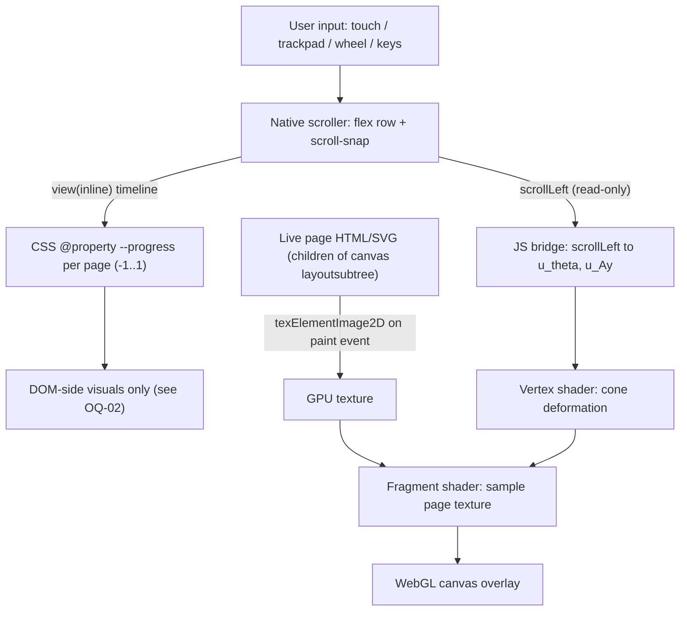

# 001: Architecture & Technical Requirements

Status: Draft

## System overview



Three layers with strict ownership:

| Layer | Owns | Must not |
|-------|------|----------|
| CSS | Input, physics, snapping, `--progress` state | n/a |
| JS bridge | Reading `scrollLeft`, computing uniforms, texture upload calls | Move DOM, listen to raw input, write scroll position |
| GPU | Geometry deformation and pixel output | n/a |

## Non-negotiable requirements

### Zero-JS physics engine
- **ARCH-01**: All dragging, touch tracking, momentum, and snapping MUST come from native
  CSS scrolling (`overflow-x` + `scroll-snap-type`).
- **ARCH-02**: The codebase MUST NOT include JS animation or physics libraries (GSAP, Framer
  Motion, react-spring, popmotion, etc.), and MUST NOT register `touchstart`, `touchmove`,
  `touchend`, `pointer*`, `mouse*`, or `wheel` listeners for navigation.
- **ARCH-03**: JS MUST NOT move or transform DOM elements (no writes to `style.transform`,
  `left`, `scrollLeft`, `scrollTo()`, etc.) to produce navigation or animation.

### Separation of state and visuals
- **ARCH-04**: The page container MUST be a standard horizontal flex container where each
  page is one scroll-snap target.
- **ARCH-05**: Each page MUST expose a registered CSS custom property `--progress`
  (`@property`, `<number>`), animated from `-1` to `1` by a `view(inline)` scroll-driven
  animation, where `0` means the page is centred/snapped in the viewport.
- **ARCH-06**: JS's only animation-state input MUST be `scrollLeft` of the scroller,
  read once per frame and converted to shader uniforms.

### HTML-in-Canvas
- **ARCH-07**: Page content MUST reach the GPU via the native HTML-in-Canvas API:
  a `<canvas layoutsubtree>` whose child elements are uploaded with
  `WebGLRenderingContext.texElementImage2D`. Re-upload MUST happen in response to the
  canvas `paint` event (i.e. only when content actually changed), not every frame.
- **ARCH-08**: Target platform is **Chrome 157+**. The PoC MAY require a Chrome flag if the API
  isn't enabled by default; if so, that MUST be documented in the README.
- **ARCH-09**: The codebase MUST NOT use `html2canvas`, `dom-to-image`, SVG-`foreignObject`
  rasterisation, or any other DOM-to-image workaround.

### Deformation math
- **ARCH-10**: Page deformation MUST be computed in the vertex shader using the cone model
  of Hong, Card & Chen, exactly as specified in [040](040-cone-vertex-shader.md).

## Technical requirements

| ID | Requirement |
|----|-------------|
| ARCH-11 | TypeScript with `strict: true`; Vite as dev server and bundler. |
| ARCH-12 | WebGL2 context. Renderer choice (raw WebGL2 vs Three.js) is pending: see **OQ-01**. |
| ARCH-13 | The render loop uses `requestAnimationFrame` and draws only while the scroll position is changing, or after a texture `paint` update. Otherwise it idles. |
| ARCH-14 | The canvas backing store is sized to `devicePixelRatio`, capped (e.g. at 2), and resized via `ResizeObserver`. |
| ARCH-15 | Runtime dependencies: none beyond the renderer decided in OQ-01. |
| ARCH-16 | Accessibility: page content stays real DOM, so text remains selectable and reachable by screen readers; keyboard scrolling (arrows, PgUp/PgDn) works natively through the scroller. |

## Repository layout (target)

```
/
├─ AGENTS.md            # agent rules
├─ README.md
├─ specs/               # source of truth
├─ index.html
├─ src/
│  ├─ main.ts           # bootstrap
│  ├─ style.css         # layout, scroll-snap, @property, scroll timelines
│  ├─ gl/               # context, geometry, texture upload, render loop
│  └─ shaders/          # cone.vert.glsl, page.frag.glsl
└─ public/
```

## References

- Hong, L., Card, S. K., & Chen, J. (2006). *Turning Pages of 3D Electronic Books.*
  IEEE Symposium on 3D User Interfaces. (The user brief cites it as "Deforming Pages of
  3D Electronic Books"; the title needs confirming, see **OQ-07**.)
- WICG HTML-in-Canvas proposal (`layoutsubtree`, `drawElementImage`, `texElementImage2D`, `paint` event).
- CSS Scroll-Driven Animations (`view()` timelines, `animation-range`).
- CSS Properties & Values API (`@property`).
