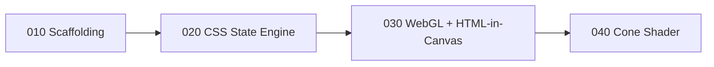

# Specifications

## Index

| ID  | Spec | Status |
|-----|------|--------|
| 000 | [Vision & Scope](000-vision.md) | Draft |
| 001 | [Architecture & Technical Requirements](001-architecture.md) | Draft |
| 010 | [Phase 1: Project Scaffolding](010-scaffolding.md) | Draft |
| 020 | [Phase 2: CSS State Engine](020-css-state-engine.md) | Draft |
| 030 | [Phase 3: WebGL Overlay & HTML-in-Canvas](030-webgl-html-in-canvas.md) | Draft |
| 040 | [Phase 4: Cone Vertex Shader & Uniform Wiring](040-cone-vertex-shader.md) | Draft |
| —   | [Open Questions & Decisions](open-questions.md) | Living |

## Spec lifecycle

`Draft` → (human review) → `Approved` → (implemented and verified) → `Done`

- Only `Approved` specs may be implemented.
- Edits to an `Approved` spec return it to `Draft` until re-approved.

## Spec format

Each phase spec contains:

1. **Goal**: one paragraph.
2. **Requirements**: numbered, with IDs (`<PREFIX>-NN`), written as testable "MUST/SHOULD" statements.
3. **Design notes**: the intended approach (not code).
4. **Acceptance criteria**: how a human or agent verifies the phase is complete.
5. **Out of scope**.
6. **Tasks**: an ordered checklist used during implementation.

## Phase order

Requirement ID prefixes: `VIS` (vision), `ARCH` (architecture), `SCF` (scaffolding),
`CSS` (state engine), `GL` (WebGL/HTML-in-Canvas), `SHD` (shader).
